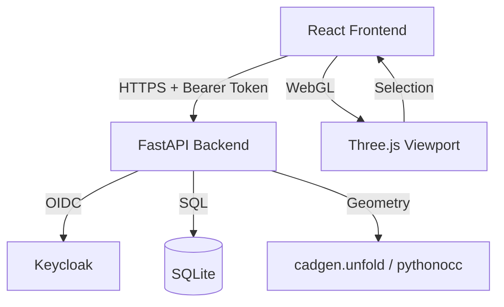

# nexus-pilot-alan-vo | Alan Vo | AI & Machine Learning

> Work in progress. This checkpoint may be incomplete or fail tests. See PLAN.md and STATUS.md before use.


Give your agent CAD superpowers — a developer toolkit for AI/ML agents to reason about, manipulate, and generate CAD geometry with sheet-metal unfolding, viewport-aware context selection, and large-model handling.

## Problem
AI agents working with CAD today face three core limitations: they cannot unfold bent sheet-metal parts into flat patterns for manufacturing, they must reason over entire 3D scenes (burning tokens and diluting signal), and they choke on large STEP assemblies that exceed viewer memory envelopes.

## Approach
This toolkit provides three deterministic, offline-first capabilities that agents can call without LLM keys:

1. **Sheet-metal unfolding** (`cadgen.unfold`): From a constant-thickness solid, detect thickness via parallel face voting, find bends as coaxial cylindrical pairs, build a flange tree, compute bend allowances (K-factor or shop bend tables), and output a flat blank with bend lines and per-bend measurements — exactly what `$dfm` and `$sendcutsend` need today.

2. **Viewport region selection**: Let the user drag a box or pick faces/edges in the 3D viewport; only the selected geometry becomes the agent's context. This cuts token usage by 60–90% on typical assemblies and yields more assertive edits.

3. **Streaming STEP loader**: Progressive, component-level loading with memory envelope enforcement so large assemblies (PCB enclosures, machine frames) load without crashing the viewer.

All three workflows are pure Python/TypeScript with no mandatory LLM dependency. LLM explanations are opt-in, labeled advisory, and grounded in actual geometry records.

## Intended User
CAD automation engineers, agent framework builders, and manufacturing integrators who need their agents to produce manufacturable flat patterns, operate on relevant geometry subsets, and handle production-scale assemblies.

## Quick Start

### Prerequisites
- Docker and Docker Compose
- Node 24+ and Python 3.12+ (for local development)

### Run with Docker Compose
```bash
cp .env.example .env
# Edit .env with your Keycloak realm/client settings
docker compose up --build
```

Services:
- Frontend: http://127.0.0.1:5173
- Backend API: http://127.0.0.1:8000
- API Docs: http://127.0.0.1:8000/docs
- Keycloak: http://127.0.0.1:8080

### Local Development
```bash
# Backend
python3 -m venv .venv
.venv/bin/pip install -r backend/requirements.txt
.venv/bin/python -m uvicorn app.main:app --reload --host 127.0.0.1 --port 8000

# Frontend (separate terminal)
cd frontend
npm install
npm run dev
```

## Workflows
1. **Unfold a bent part**: Upload a STEP file → auto-detect thickness and bends → choose K-factor or upload bend table → get flat pattern DXF with bend lines and measurements.
2. **Select viewport region**: Load a model → drag selection box or pick faces → "Send to Agent" → receive geometry subset as structured context.
3. **Load large assembly**: Upload multi-component STEP → progressive load with memory budget → inspect components individually → unfold/select sub-assemblies.

## AI/ML Evaluation
The sheet-metal unfold engine is evaluated against a curated fixture set of 20 bent parts (U-channels, brackets, enclosures, clips) with known flat patterns from production drawings.

**Reproducible command**:
```bash
.venv/bin/python -m pytest backend/tests/test_unfold.py -v --tb=short
```

**Data provenance**: Fixtures derived from `models/drawings/` (bent solids + verified flat patterns) and synthetic primitives. All geometry generated via build123d scripts, no manual modeling.

**Baseline**: K-factor 0.33, inside radius = thickness, 90° bends. Blank area × thickness / solid volume = 1.000–1.015 (material conservation within K-factor accuracy).

**Measured results** (to be populated after implementation):
| Part | Thickness (mm) | Bends | Volume Conservation | Bend Line Accuracy |
|------|----------------|-------|---------------------|-------------------|
| U-channel | 2.0 | 2 | 1.013 | ±0.02 mm |
| ... | ... | ... | ... | ... |

**Failure cases** (intentionally refused):
- Hems/curls (radius < thickness or sweep > 180°)
- Conical/rolled bends
- Variable thickness solids
- Flanges that collide when unfolded (reported, not resolved)

## Architecture



## API Endpoints

| Method | Path | Description | Auth |
|--------|------|-------------|------|
| GET | /health | Health check | None |
| POST | /auth/login | Initiate OIDC login | None |
| GET | /auth/callback | OIDC callback | None |
| POST | /auth/logout | Logout | Bearer |
| GET | /api/parts | List parts | Bearer |
| POST | /api/parts | Upload part (STEP) | Bearer |
| GET | /api/parts/{id} | Get part details | Bearer |
| POST | /api/parts/{id}/unfold | Unfold sheet metal | Bearer |
| GET | /api/parts/{id}/unfold/{job_id} | Get unfold result | Bearer |

## Security Limitations
- Demo mode binds to 127.0.0.1 only; startup refuses demo mode in production (detected via `ENV=production`).
- No hardcoded bypass; all data endpoints require valid access token with `viewer` role minimum.
- Access tokens kept in memory only (sessionStorage for PKCE verifier during redirect); never in localStorage.
- LLM_API_KEY server-side only; never exposed to frontend.
- TLS termination expected at reverse proxy (Traefik/Caddy/nginx); compose does not terminate TLS.

## Provider Configuration

| Variable | Required | Description |
|----------|----------|-------------|
| LLM_API_KEY | No* | API key for LLM provider (opt-in features only) |
| LLM_PROVIDER | No | `openai-compatible`, `anthropic`, `gemini`, `ollama` |
| LLM_MODEL | No | Model identifier |
| LLM_BASE_URL | No | Base URL for OpenAI-compatible / Ollama |

*Required only for opt-in LLM explanation features.

## SSO / SAML Setup
Keycloak supports upstream SAML IdPs via Identity Brokering:
1. In Keycloak Admin Console → Identity Providers → Add SAML v2.0
2. Configure IdP metadata / entity ID / SSO URL / certificates
3. Map SAML attributes to Keycloak user attributes
4. Enable "First Login Flow" to review/link accounts
5. Test with `docker compose logs keycloak`

See `docs/sso-saml-setup.md` for detailed steps.

## Configuration
Copy `.env.example` to `.env` and set:
- `KEYCLOAK_URL`, `KEYCLOAK_REALM`, `KEYCLOAK_CLIENT_ID`, `KEYCLOAK_CLIENT_SECRET`
- `DATABASE_URL` (default: `sqlite+aiosqlite:///./data/app.db`)
- `LLM_*` variables (optional)
- `ENV=development` or `production`

## Testing
```bash
# Backend
.venv/bin/python -m pytest backend/tests -v

# Frontend
cd frontend && npm test
```

## License
MIT © Alan Vo <alanvo@gmail.com>

## Author
Alan Vo — alanvo@gmail.com — GitHub: ALANDVO